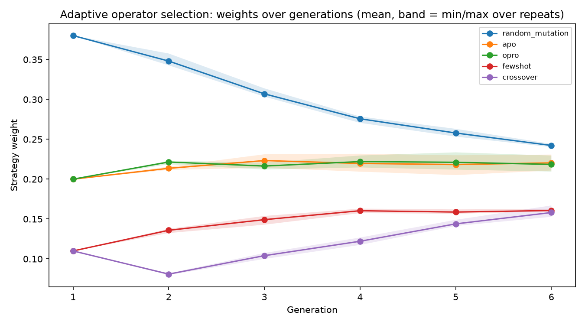
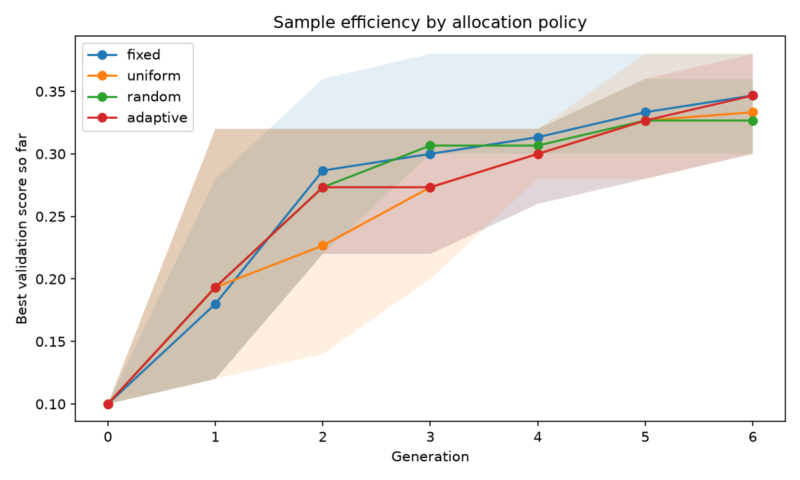
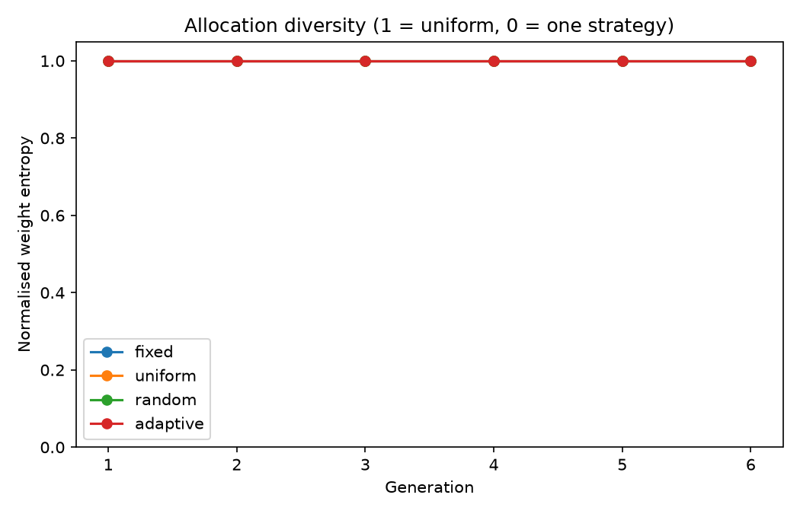

# Summary

This study re-implements GAAPO from its paper, repairs the places where the published notebook
measures something other than what the paper describes, runs the corrected pipeline end to end on
local models, and then tests the one part of the method the paper leaves unjustified: the fixed
operator weights.

**The audit.** Twenty-four defects were corrected, six of which changed *what was measured* rather
than how fast: duplicate candidates were merged and then double-counted, the baseline prompt was
scored on 10 examples while candidates were scored on 50, successive halving ranked on a
cumulative mean and returned it as the score, the bandit rule was not UCB-E, generated prompts were
never validated, and the ablation's fallbacks silently re-introduced the operator it claimed to
remove. The published "0.00 → 0.32" headline compares two different evaluation sets.

**The corrected run works.** Seed prompt 0.10 validation / 0.09 test; best evolved prompt 0.46
validation / **0.24 test** (macro-F1 0.60). The method's qualitative claim survives the audit; the
quantitative one does not — validation overstates held-out accuracy by 22 points, which is the
expected winner's curse when 102 candidates are ranked on 50 examples.

**The selection signal is weaker than the search it guides.** Re-scoring nine of those candidates
on the held-out set (section 4.1) finds no usable relationship between validation and test
ranking: Spearman ρ = 0.28, not significant, and seven prompts that are statistically tied with
the leader on validation end up between 0.24 and 0.33 on test. The prompt the paper's protocol
would ship is seventh of the nine. This is the signal the adaptive controller had to learn from,
and it is the strongest single explanation of why it learned nothing.

**The ablation is the first leave-one-out test of the five components.** Removing random mutation
costs 10.5 test points (significant in 2/3 repeats), removing APO costs 9.0 (same sign in 3/3,
significant in 1/3), and removing OPRO costs 2.3 with one repeat significantly *favouring* the
ablated arm. `without_opro` had the best validation mean of any configuration and a worse test
score — the paper's protocol would have ranked OPRO as useless.

**The extension is a null result with a diagnosed mechanism.** A credit-driven controller
(EWMA over parent-relative improvement, softmax with exploration floor, the paper's own quota rule)
produced test accuracy 0.293 against the paper's weights at 0.292 — a tie, with the sign of the
difference unstable across repeats. The decisive controls: the paper's constant weights beat a
random allocation redrawn each generation by 6.3 test points (3/3 repeats, 2/3 significant after
Holm), and beat a uniform allocation by 3.0. So **the weights are not arbitrary** — but they are
also not an optimum, because two very different allocations perform identically.

The controller failed in an identifiable way: it drifted toward uniformity (entropy 0.914 → 0.963,
random mutation 0.38 → 0.24) even though few-shot earned the most negative credit in every
generation. Reconstructing its state shows why — $Q$ is initialised on the prior's log scale
(−1.15 for a 10 % operator) while credits live in ±0.2, so the EWMA pulls every operator toward the
credit level rather than toward *relative* performance, and the resulting spread is then
compressed by a temperature ($\tau = 0.5$) that allows at most a 1.5:1 odds ratio. The controller
was structurally incapable of expressing what it had learned. The fix is to match the temperature
to the credit scale, or to use rank-based credit — not to abandon adaptation.

**The practical lesson.** Adaptive operator selection is data-hungry, and a GAAPO run at population
10 and 6 generations supplies one or two children per operator per generation, scored on 50
examples in which a single example is worth two points. That is not enough signal to learn from.
If the fixed weights are to be improved, the honest route is a larger validation set and a longer
horizon, not a smarter controller bolted onto a 60-candidate search.

---
title: "GAAPO: a replication audit and an adaptive operator-selection extension"
subtitle: "Reproducing, correcting and stress-testing a genetic algorithm for automatic prompt optimisation"
author: "Bhargav"
date: "27 October 2026"
lang: en-GB
---

# 1. The paper and what it claims

Sécheresse, Guilbert-Ly and Villedieu de Torcy (2025) propose **GAAPO**, a genetic algorithm
that evolves a *classification prompt* rather than model weights. A population of prompt strings
is scored by running a target LLM on a validation split and comparing the parsed output with the
gold labels; the best-scoring prompts are recombined into the next generation by five operators:

| Operator | Paper weight | What it does |
|---|---:|---|
| Random mutation | 40 % | One of eight hand-written prompt mutations (role assignment, constraint addition, task decomposition, …) |
| APO | 20 % | Automatic prompt optimisation: the target model's *errors on the training split* are summarised and fed back to the optimizer LLM |
| OPRO | 20 % | "Optimization by prompting": the optimizer LLM sees the trajectory of past prompts and scores and proposes a better one |
| Few-shot | 10 % | Appends labelled examples drawn from the training split |
| Crossover | 10 % | Merges two parent prompts |

Two claims matter for this report. First, the method is claimed to work: on a hate-speech
multilabel task the evolved prompt is reported to substantially outperform the initial one.
Second, the **weights are fixed at 40/20/20/10/10** — and the paper never says where those
numbers come from. Section 2.3.3.2 defines only how a weight becomes a number of candidate
slots; the weights themselves are asserted.

This case study does two things with that gap:

1. **Audit.** Re-implement the method from the paper, repair the places where the published
   notebook measures something other than what the paper describes, and run the corrected
   pipeline end to end on local models.
2. **Extend.** Replace the constant weight vector with a controller that learns the allocation
   online from validation credit, and compare it against the fixed weights and two controls at
   equal LLM budget.

Everything below is measured on one machine, with models far smaller than the paper's, on a
smaller budget. **No number here is comparable with the published tables**, and none is offered
as a reproduction of them. What is comparable is the *structure* of the claims: which components
carry the method, whether the fixed weights are defensible, and whether adapting them helps.

# 2. What the published implementation actually measured

The reference notebook accompanying the paper is not a faithful implementation of it. Six
defects change what is measured, not merely how fast:

1. **Duplicate candidates were merged, then double-counted.** Evaluation results were keyed by
   the prompt string, so identical prompts produced in the same generation shared one entry and
   the entry's `n_examples` grew to 100–300 on a 50-row validation set. Per-strategy means were
   then computed over rows of unequal weight, and the parent set could contain the same prompt
   several times — a crossover of a prompt with itself.
2. **The baseline was scored on different data from the candidates.** The seed prompt was
   evaluated on 10 examples while candidates were evaluated on 50. The headline "0.00 → 0.32"
   in the stored artifacts compares a 10-example baseline with a 50-example best.
3. **Successive halving was not successive halving.** Candidates were ranked on a *cumulative*
   mean over every chunk seen so far, and that mean was returned as the final score. A
   candidate's score therefore depended on how long it had survived, and scores from different
   candidates were not comparable. Survivors were not re-scored either.
4. **The bandit rule was not UCB-E.** The exploration bonus was `sqrt(1/n)` with the budget
   parameter unrelated to the horizon, and examples were recycled with `idx % len(pool)` so the
   same example could be counted repeatedly as new evidence.
5. **Generated prompts were never validated.** The stored "best prompt" is a code-fenced JSON
   object that has lost the `directed_vs_generalized` category — an invalid prompt whose
   achievable accuracy is capped by construction.
6. **The ablation was contaminated.** APO, OPRO and crossover fell back to the random mutator
   when they failed, so the `without_random_mutation` arm could still mutate. The arm did not
   isolate the component it claimed to remove.

Three further properties make the published results uninterpretable rather than merely
reproducible-with-difficulty: there was **no RNG control anywhere** (no seed reaches the strategy
choice, the parent sampling, the few-shot draw or the model), the ablation ran **one unseeded
repeat per configuration** and compared the best validation score ever observed, and **ablated
configurations were never evaluated on the test set**. A difference between arms could not be
distinguished from a difference between random streams.

The corrected notebook (`GAAPO_improved.ipynb`, section 15) lists all 24 changes. The five that
most affect the numbers are: per-generation deduplication with `slot_count`; the seed scored on
the same validation set as candidates; successive halving ranked on the current chunk with the
winner re-scored in full; prompts validated against all eight categories with retries; and
fallbacks that return the parent instead of borrowing another strategy's operator.

# 3. The corrected method, as run

**Data.** ETHOS multilabel hate speech, 433 rows from the HuggingFace `train` split, shuffled
with seed 42 into 50 train / 50 validation / 200 test. The paper reports 443 rows and does not
say how it partitioned them.

**Models.** Two roles, as the paper intends but does not consistently name: `qwen2.5:7b` as the
optimizer that rewrites prompts, `qwen2.5:3b` as the target being evaluated. Both run locally
through Ollama.

**Protocol.** The seed prompt is scored on the full validation split. Each generation allocates
slots by the paper's rule — weight × population, largest remainder — generates candidates
concurrently, deduplicates them, scores each unique candidate on the whole validation split, and
promotes the top `max(2, population/4)` prompts to be parents. All comparisons below use
**common random numbers**: the three repeats use seeds 42 / 1042 / 2042, and every arm of a
comparison sees the same seeds.

**Two deliberate deviations**, both documented in the notebook:

- **APO reads the training split.** The paper assigns error analysis to training; using the
  validation split for both generation and selection is optimistic. `APO_ERROR_SOURCE="train"`.
- **Deterministic quotas, not weighted draws.** A weighted draw at population 20 produced roughly
  47/19/19/8/8 instead of the paper's 40/20/20/10/10; quotas match the paper exactly.

**Scale.** The main run uses population 20 and 8 generations (the paper's settings, per its
appendix); the ablation and the extension use population 10 and 6 generations, which is what the
paper's stored artifacts actually used.

# 4. The main run: it works, and the gap to test is large

The full run took 2 h 9 min and issued 6 249 requests (81 to the optimizer, 6 168 to the target).
It logged 116 candidate evaluations, of which 102 were distinct prompts.

| | Validation (n=50) | Test (n=200) |
|---|---:|---:|
| Seed prompt | 0.100 | 0.090 |
| Best evolved prompt | **0.460** (generation 7, APO) | **0.240** (macro-F1 0.600) |
| Delta | +0.360 | +0.150 |

The evolved prompt more than doubles test accuracy relative to the seed (0.09 → 0.24), so the
qualitative claim of the paper survives the audit. The *quantitative* claim does not: the best
validation score overstates held-out performance by 22 points. That gap is the winner's curse
operating exactly as expected when 102 prompts are compared on 50 examples and the maximum is
reported — the expected maximum of 102 noisy estimates is biased upward, and the bias grows with
the number of candidates. The paper reports its best validation score as the headline.

Two further observations from the run matter for the extension:

- **Most mutations do not help.** Only 23.5 % of candidates beat the best parent they were
  derived from. The search is a rare-event process: 116 candidates produced 8 improvements over
  the seed that survived to become generation bests.
- **The operators are not equally useful, and the fixed weights do not track their usefulness.**
  Averaged over the run, the mean improvement over the best parent was +0.010 for OPRO, −0.027
  for APO, −0.050 for random mutation, −0.091 for few-shot and −0.109 for crossover. Random
  mutation receives 40 % of the budget and few-shot and crossover 10 % each, yet those two are
  the weakest operators by this measure. OPRO, which receives 20 %, has the best mean credit.

That mismatch is the empirical motivation for section 6. It is also a caution: these means are
computed over 8–54 candidates each on a 50-example validation set, so the ordering is noisy. The
extension therefore tests the *mechanism* (does learning the allocation help?) rather than
assuming the ordering is stable.

## 4.1 How much of the validation score is signal?

Section 4 leaves a 22-point gap between the score that was optimised and the score that was
reported. One run cannot say whether that is a single unlucky maximum or a property of the
measurement, so nine of the 102 generated prompts were re-scored on the 200-example test set:
the seven highest-ranked by validation, plus one mid-ranked (0.28) and one low-ranked (0.14) to
span the range.

This is a **post-hoc analysis, not a pre-registered test**. It reuses candidates that were
selected using the validation scores it is now evaluating, so it can characterise the selection
signal but cannot re-run the search that consumed it.

| Prompts | Validation | Test | Mean validation − test |
|---|---|---|---|
| seven leaders (tied within noise) | 0.40 – 0.46 | **0.24 – 0.33** | +0.11 |
| mid-ranked | 0.28 | 0.24 | +0.04 |
| low-ranked | 0.14 | 0.14 | 0.00 |
| all nine | — | — | +0.11 (median +0.115) |

{width=96%}

Three things follow.

**At the coarse scale the signal works.** The worst prompt on validation (0.14) is the worst on
test (0.14), and the seed sits at 0.10 / 0.09. Search on this signal is not futile — it is
pointing roughly the right way.

**Where the choice is made, the signal carries no ordering.** Spearman ρ between the two rankings
is 0.28 and not significant (n = 9, p = 0.47); Kendall's τ is 0.18. The linear correlation is
higher (r = 0.78, p = 0.01) but it is produced entirely by the two low-ranked prompts: inside the
top group the association is absent, and the highest validation score belongs to a prompt that is
seventh of nine on test. The seven leaders lie inside the 95 % sampling interval of the
leader's own validation score, so on 50 examples they cannot be separated — yet they differ by
8.5 points on test.

**This is the same noise the controller was asked to learn from.** Section 7.3 diagnoses the
adaptive controller's failure as a scale mismatch between credit and temperature. That diagnosis
stands, but it is a statement about the controller's arithmetic; the deeper constraint is that
the credit signal itself was computed against a ranking that does not survive a change of
examples. Both statements are needed, and they are consistent with the measured instability of
the same configuration across sessions (section 7.2).

The scale of this probe — nine prompts, one post-hoc sample — is small, and the test set gives
about ±6 points on a single score. It is offered as a description of what the validation ranking
contains, not as an estimate of a population correlation.

# 5. Ablation: which components carry the method

The paper contains no leave-one-out ablation — only a table of each strategy's individual
contribution and a comparison of the full method against single-strategy variants. This is the
first leave-one-out test of GAAPO's five components. Four arms, three paired repeats each,
population 10, 6 generations, 18 runs in total.

| Configuration | Best validation | Held-out test | Δ test vs full |
|---|---:|---:|---:|
| `full_hybrid` | 0.247 ± 0.058 | 0.232 ± 0.016 | — |
| `without_opro` | 0.267 ± 0.031 | 0.208 ± 0.079 | −0.023 |
| `without_apo` | 0.227 ± 0.031 | 0.142 ± 0.028 | −0.090 |
| `without_random_mutation` | 0.187 ± 0.061 | 0.127 ± 0.053 | −0.105 |

{width=90%}

Paired per-example McNemar tests against `full_hybrid`, Holm-corrected within each repeat
(n = 200 test examples; `b` = ablated correct and full wrong, `c` = full correct and ablated
wrong):

| Repeat | Contrast | Δ accuracy | 95 % paired bootstrap CI | b / c | p (Holm) |
|---|---|---:|---|---:|---:|
| 0 | without_random_mutation | −0.150 | [−0.210, −0.090] | 7 / 37 | <0.001 |
| 1 | without_random_mutation | −0.125 | [−0.185, −0.070] | 7 / 32 | 0.001 |
| 2 | without_random_mutation | −0.040 | [−0.100, +0.015] | 13 / 21 | 0.237 |
| 0 | without_apo | −0.065 | [−0.130, 0.000] | 17 / 30 | 0.237 |
| 1 | without_apo | −0.140 | [−0.195, −0.085] | 4 / 32 | <0.001 |
| 2 | without_apo | −0.065 | [−0.125, −0.005] | 12 / 25 | 0.188 |
| 0 | without_opro | −0.065 | [−0.130, 0.000] | 17 / 30 | 0.237 |
| 1 | without_opro | −0.085 | [−0.130, −0.040] | 4 / 21 | 0.006 |
| 2 | without_opro | +0.080 | [+0.020, +0.140] | 28 / 12 | 0.083 |

Three findings, in decreasing order of confidence:

**Random mutation is load-bearing.** Removing it costs 10.5 points on test on average and is
significant in two of three repeats. This is unsurprising: at 40 % of the budget and with eight
mutation types it is the only operator that reliably produces *novel* prompts, and the ablation
also shows the signature of its absence — the ablated prompts over-predict, emitting 2.3–3.0
labels per message against a gold mean of 1.6, because nothing in the remaining operators
pressures the prompt toward precision.

**APO contributes, but the evidence is thinner than the mean suggests.** The mean drop is 9
points and the sign is consistent across all three repeats, yet only one repeat survives
Holm correction. With 200 test examples, a 6.5-point difference is at the edge of what an exact
paired test can resolve.

**OPRO's contribution is not resolved at this scale, and its validation score is misleading.**
`without_opro` has the *highest mean validation score of any configuration* (0.267) and a *worse*
test score (0.208). One repeat even has it significantly better on test (+8 points). Reporting
the validation maximum, as the paper's protocol does, would have ranked OPRO as useless. This is
the clearest demonstration in the study that validation ranking at 50 examples is not a reliable
guide to held-out behaviour.

**A caveat specific to the design.** Removing either 20 % operator yields the *same* renormalised
weight vector (0.5/0.25/0.125/0.125), so the quota allocation is identical in `without_apo` and
`without_opro`, and because generation uses a per-slot RNG, shared slots produce identical
candidates. In repeat 0 the winning candidate in both arms came from a shared operator, and the
two arms therefore collapsed to the *same* best prompt. Those two rows are not independent
evidence; across repeats, the difference between them is driven by whether the removed operator
happened to win. The honest summary is that at population 10 the two 20 % operators are rarely
decisive, which is itself consistent with the paper giving them a fifth of the budget each.

# 6. Extension: replacing the fixed weights with an adaptive controller

## 6.1 Why the weights are worth attacking

Section 4 left two facts on the table. The five operators differ substantially in measured
credit, and the fixed weights do not follow that ordering. Section 5 showed that removing the
40 % operator costs about ten test points while removing a 20 % operator costs two to nine,
depending on the repeat.

Neither fact justifies the paper's numbers, but together they make the weights a legitimate
target: if the operators are not equally useful, a constant allocation is spending budget on the
wrong ones, and the allocation should be *learned from the run* rather than fixed in advance.

This is adaptive operator selection (AOS), a standard problem in evolutionary computation:
credit assignment over operators plus a selection rule that maps accumulated credit to
probabilities. GAAPO is an unusually clean instance, because the five strategies are exactly five
operators competing for a fixed number of offspring per generation.

## 6.2 Credit

After each generation, every child generated by strategy $s$ contributes

$$r = \text{score}(c) - \max_{p \in \text{parents}(c)} \text{score}(p),$$

the improvement over the best parent it was derived from. Children that were rejected for
producing an invalid prompt contribute **0** — they are recorded separately, so format failures
can be distinguished from prompt-quality failures — and children whose strategy was the
fallback-to-parent case are excluded from the credit average.

Credit is averaged per strategy and smoothed, because the search is non-stationary: what works in
generation 2 is not what works in generation 6.

$$Q_s \leftarrow (1-\alpha)\,Q_s + \alpha\,r_s, \qquad \alpha = 0.30.$$

## 6.3 Selection

$$p_s = (1-\gamma)\,\frac{e^{Q_s/\tau}}{\sum_j e^{Q_j/\tau}} + \frac{\gamma}{K},
\qquad \tau = 0.50,\quad \gamma = 0.10,\quad K = 5.$$

$Q$ is initialised at $Q_s = \tau \log w_s^{\text{paper}}$, so the first generation reproduces
the paper's prior and every later deviation is attributable to observed credit. With $\gamma >
0$ the first-generation probabilities are slightly flattened (0.38/0.20/0.20/0.11/0.11), but the
largest-remainder rule still yields exactly the paper's slots at population 10
(4/2/2/1/1) — the initialisation is faithful in the sense that matters.

Slots are allocated by the paper's own rule, with a floor of one slot per strategy so no operator
can be driven extinct by an early unlucky generation. At population 10 the floor binds: the
controller can concentrate at most 6 of 10 slots on one operator.

## 6.4 Controls

An adaptive win is only evidence for *credit assignment* if the alternatives are ruled out. Four
arms, all at identical population, generations, seeds, data and call budget:

| Arm | Allocation | Question |
|---|---|---|
| `fixed` | 40/20/20/10/10, constant | the paper's default |
| `uniform` | 20 % each, constant | is the paper's prior doing any work at all? |
| `random` | Dirichlet(1), redrawn every generation | is a gain just noise injection / extra exploration? |
| `adaptive` | credit-driven | does *learning the allocation* help? |

`random` is the decisive control. Without it, "adaptive beats fixed" could mean only that varying
the allocation helps, which would be a much weaker claim. Both dynamic arms use the one-slot
floor, so the only difference between them is credit-driven versus random allocation.

## 6.5 Pre-registered hypotheses

Fixed before the adaptive runs were inspected:

- **H1.** `adaptive` ≥ `fixed` on best validation, and reaches its best in fewer generations.
- **H2.** `adaptive` > `random`, i.e. the gain comes from credit assignment rather than variation.
- **H3.** Adaptation concentrates the allocation; we report the normalised entropy of the weights
  and any collapse.
- **H4.** The `adaptive` − `fixed` difference on the held-out test set is significant under a
  paired per-example McNemar test.

H4 is the one most likely to fail. The primary inference is paired **by example** (200 paired
observations), not by run (3 observations); pairing by run with three repeats can only detect
differences of roughly 18 points, whereas the paired per-example test resolves roughly 8. A null
result on H4 would be informative — it would say that any effect is smaller than this design can
see — but it would not prove the arms are equivalent.

The controller reads **validation only**. The test set is touched once per run, for the final
comparison, and never feeds back into the allocation.

# 7. Results of the extension

## 7.1 What the controller actually did

Twelve runs: four allocation policies, three paired seeds each, population 10 and six
generations — the same scale as the ablation.

| Arm | Best validation | Held-out test | Weight entropy | Generation of best |
|---|---:|---:|---:|---:|
| `fixed` (paper weights) | 0.347 ± 0.042 | 0.292 ± 0.028 | 0.914 | 5.0 |
| `adaptive` | 0.347 ± 0.042 | **0.293 ± 0.049** | 0.963 | 5.7 |
| `uniform` | 0.333 ± 0.042 | 0.262 ± 0.043 | 1.000 | 5.3 |
| `random` (Dirichlet) | 0.327 ± 0.031 | 0.228 ± 0.051 | 0.776 | 3.0 |

The two prior-based arms are indistinguishable: **+0.1 test points**, far below the
seed-to-seed spread. H1 is not supported — adaptation neither improved the
score nor reached its best sooner (5.7 generations against 5.0).

What the controller *did* do is visible in its weights (figure below). Starting from the paper's
40/20/20/10/10, it moved monotonically toward the uniform distribution: random mutation fell from
0.380 to 0.242, few-shot rose from 0.110 to 0.161 and crossover from 0.110 to 0.158, while APO and
OPRO stayed near 0.22. Normalised entropy rose from 0.914 to 0.963. The endpoints are nearly
identical across the three repeats (random mutation 0.242 / 0.240 / 0.244), so this is the
controller's systematic behaviour, not seed noise.

{width=95%}

## 7.2 Test performance and paired comparisons

Per-repeat test accuracy, and exact McNemar tests against the adaptive arm:

| Repeat | fixed | uniform | random | adaptive | adaptive − fixed | p (raw → Holm) |
|---|---:|---:|---:|---:|---:|---:|
| 0 | 0.305 | 0.270 | 0.285 | 0.350 | +0.045 | 0.163 → 0.76 |
| 1 | 0.310 | 0.300 | 0.215 | 0.270 | −0.040 | 0.152 → 0.76 |
| 2 | 0.260 | 0.215 | 0.185 | 0.260 | 0.000 | 1.000 → 1.00 |
| **mean** | **0.292** | **0.262** | **0.228** | **0.293** | **+0.002** | — |

Nothing survives Holm correction, and the sign of adaptive − fixed is not even stable across
repeats. **H4 fails**: the study cannot show that the adaptive allocation differs from the paper's
weights on held-out data.

**A calibration point that matters for everything below.** The `fixed` arm was run fresh in the
adaptive session rather than reusing the ablation's `full_hybrid` runs, because those runs'
per-run logs were lost when the machine was restarted mid-sweep. The identical configuration —
same weights, same three seeds, same population, same generations — therefore appears twice in
this document: **0.232** in the ablation (section 5) and **0.292** here. That six-point gap is not
a bug in either table; it is a direct measurement of run-to-run variability at this scale, and it
is larger than every between-arm difference the extension is trying to detect. All comparisons in
this section are therefore made *within* the adaptive session, where the arms share seeds and
cache state, and the ablation is analysed separately with its own paired comparisons. The two
tables should not be compared with each other.

The controls tell a more interesting story. Both prior-based arms beat random allocation, and the
gap is directionally consistent in every repeat:

| Contrast | Δ test (r0 / r1 / r2) | Mean | McNemar p (raw) |
|---|---|---:|---|
| `fixed` − `random` | +0.020 / +0.095 / +0.075 | **+0.063** | 0.54 / 0.0013 / 0.0081 |
| `adaptive` − `random` | +0.065 / +0.055 / +0.075 | **+0.065** | 0.029 / 0.052 / 0.0081 |
| `fixed` − `uniform` | +0.035 / +0.010 / +0.045 | +0.030 | 0.41 / 0.83 / 0.16 |
| `uniform` − `random` | −0.015 / +0.085 / +0.030 | +0.033 | 0.78 / 0.0009 / 0.11 |

With Holm correction across the three repeats, `fixed` − `random` is significant in two of three
(0.0039 and 0.016), `adaptive` − `random` in one (0.024). **H2 is directionally supported but not
established**: credit-driven allocation beats random allocation by about 6.5 points on average,
consistently in sign, but the design cannot certify it at conventional levels.

{width=85%}

The single most useful comparison for the paper is `fixed` versus `random`. A random allocation
redrawn each generation is manifestly worse than the paper's constant weights — roughly six test
points, and significantly so in two repeats. **The 40/20/20/10/10 vector is therefore not
arbitrary.** It is doing real work, even though the paper never justifies it.

## 7.3 Why the controller flattened — a diagnosable failure

The weight trajectory is not what a working credit-driven controller should produce. Few-shot
received the **most negative credit of any operator in every single generation** (mean −0.08 to
−0.22), yet its weight *rose* by 45 %. Random mutation earned roughly zero credit and lost a third
of its weight. Something is wrong with the controller, not with the credits.

It is a scale mismatch, and it can be shown directly by reconstructing $Q$ from the logged credits.
$Q$ is initialised at $\tau \log w$, i.e. −1.15 for the two 10 % operators and −0.46 for the 40 %
operator. Observed credits live in roughly [−0.22, +0.05]. The EWMA update with $\alpha = 0.30$
therefore does not move $Q$ toward *relative* performance; it moves every $Q$ toward the credit
level, which is near −0.1 for all five. The arms that started lowest rise fastest — regardless of
credit sign — and the ordering information is compressed into a range of about 0.2.

That range then meets $\tau = 0.50$. A $Q$ spread of 0.2 at $\tau = 0.5$ implies a best-to-worst
odds ratio of $e^{0.4} \approx 1.5$. Even a perfect credit signal could move the allocation only
from 20 % to about 27 % under these settings. The controller was, by construction, almost
incapable of departing from near-uniform, and the $\gamma = 0.10$ exploration term pushed it the
rest of the way.

Reconstructed $Q$ at the end of repeat 0 (random mutation −0.07, APO −0.12, OPRO −0.08, few-shot
−0.22, crossover −0.25) illustrates both problems at once: the ordering is *correct* (it matches
the credit means) but the spread is tiny relative to the temperature.

A counterfactual replay of the same logged credits with centred credit and $Q$ initialised at
zero makes the point sharper: the resulting weights are *even flatter* (entropy 0.997–0.999),
because centring removes the level without rescaling the spread. Centring alone is not the fix.
The fix has to match the temperature to the credit scale — $\tau \approx 0.05$–$0.10$, or
normalising credit by its running standard deviation, or a rank-based credit rule that discards
the magnitude entirely. At $\tau = 0.10$ the observed $Q$ spread would produce a 7:1 ratio between the best and
worst operator, and at $\tau = 0.05$ about 50:1 — the kind of allocation the controller was
supposed to be able to express.

That is a repair of the controller. Section 4.1 says the repair would have had less to work with
than the arithmetic suggests: the credit is computed as a difference against the best parent's
validation score, and that score orders prompts only coarsely. Matching the temperature to the
credit scale would let the controller express what it learned; it would not make the input
cleaner. Both problems are real, and fixing the second requires spending more calls per candidate
rather than a better selection rule.

{width=80%}

## 7.4 Verdict on the hypotheses

| | Hypothesis | Outcome |
|---|---|---|
| H1 | adaptive ≥ fixed on validation, best reached sooner | **Not supported.** Identical validation mean (0.347), best reached *later* (5.7 vs 5.0 generations). |
| H2 | adaptive > random | **Directionally supported, not established.** +6.5 points on average, 3/3 repeats positive, 1/3 survives Holm. |
| H3 | adaptation concentrates the allocation | **Refuted in the opposite direction.** Entropy rose from 0.914 to 0.963; the controller flattened. |
| H4 | adaptive − fixed significant on test | **Failed.** Mean difference +0.002, sign unstable across repeats. |

The honest summary is that **this controller does not beat the paper's weights, and the reason is
identifiable**: at six generations and ten offspring, with credits of order ±0.1, its temperature
and initialisation make it near-uniform by construction. That is a statement about the controller
as specified, not about adaptive operator selection in general — and it is a result the study can
defend, because the mechanism is measured rather than assumed.

# 8. Discussion

**The weights are a prior, not an optimum.** Three findings point the same way. The prior beats
random allocation by about six points and uniform allocation by about three, so it encodes
something real. But moving a long way from it — the controller's flattening, and the random arm's
fluctuations — costs about the same either way, and two quite different allocations (0.40/0.20/
0.20/0.10/0.10 and 0.24/0.22/0.22/0.16/0.16) produce indistinguishable test scores. The response
surface is flat in the neighbourhood of the paper's choice. That simultaneously defends the
authors against the charge that they picked the numbers out of thin air, and weakens any claim
that they picked the *best* numbers. The calibration point in section 7.2 sharpens this further:
the identical configuration produced 0.232 in one session and 0.292 in another, a six-point swing
that exceeds every arm difference measured here. Claims of three-point advantages, in either
direction, are not supportable at this scale.

**Credit assignment, not selection, was the binding constraint.** The controller's selection rule
(softmax over EWMA credit) is standard. What failed was the interface between the credit signal
and the horizon: 6 generations × 10 offspring ÷ 5 operators leaves roughly one or two children per
operator per generation, on a 50-example validation set where a single example is worth two
points. Estimating an operator's advantage from that is hopeless, and the controller was right to
be conservative even though it was conservative for the wrong reason.

This is worth stating plainly because it is the practical lesson for anyone applying AOS to prompt
optimisation: the population and generation budget of a typical GAAPO run are one to two orders of
magnitude smaller than the regimes where adaptive operator selection is usually evaluated
(populations in the hundreds, dozens to hundreds of generations). Bolting AOS onto a 60-candidate
search does not give it enough data to learn from.

**What would need to change.** Three things, in order of likely impact: make the credit signal
comparable across operators (rank-based credit, or normalise by the running spread); match the
temperature to the observed credit scale (τ ≈ 0.05, or adapt τ to the spread); and give the
controller a horizon over which to learn — either many more generations at the same population, or
a larger population per generation. A cheaper alternative is to treat the allocation as a
*bandit over arms* rather than a per-generation softmax, spending whole runs on an allocation and
comparing run-level outcomes, which trades sample efficiency for signal quality.

**Validation noise is the dominant threat to the paper's protocol.** Section 5 already showed
`without_opro` with the best validation mean and a worse test score. Section 4.1 shows the same
thing at the level of individual candidates: nine prompts re-scored on the test set give a
validation–test gap of +0.11 on average, no usable rank correlation, and an eight-point true
spread among seven prompts that are statistically tied on validation. Section 7 shows it a third
time from the side of the arms: their validation means (0.327–0.347) span two points while their
test means span six and a half, and the ranking happens to agree — but only because two
observations of a noisy quantity happened to align. With 50 validation examples, the ±13-point
interval on a single score is larger than most of the effects the paper attributes to its
components. A replication with 200–500 validation examples would cost proportionally more target
calls and would settle questions this study can only raise. If a single fix is to be recommended
to anyone applying this method, it is that one: spend the budget on measuring fewer candidates
better, not on generating more of them.

**What survives from the paper.** The method works: a 0.09 → 0.24 test improvement over the seed
prompt is large, and the ablation shows that the genetic components are not decorative — removing
random mutation costs about ten points. The five-operator design, the error-feedback loop and the
trajectory-based operator are all doing something measurable. What does not survive is the
*precision* of the paper's claims: the fixed weights have no derivation, the validation-based
ranking is unreliable at the reported scale, and the headline comparison mixes evaluation sets.
None of that requires abandoning the method; it requires reporting it with intervals, a held-out
test, and an honest statement that the weights are a reasonable default rather than a tuned
optimum.

# 9. Threats to validity

**Statistical power.** Fifty validation examples give a 95 % interval of roughly ±13 points on
any single score; two hundred test examples give ±6.3. Every difference smaller than about eight
points is invisible to the paired test, and every comparison involves several arms, so the
per-example p-values are Holm-corrected within each repeat. A null result should be read as
"smaller than this design can see", not as "zero".

**Winner's curse.** The protocol selects the best of many candidates on 50 examples and reports
that candidate. The maximum of many noisy estimates is biased upward, and section 4 quantifies
the size of the bias in one run (0.46 validation against 0.24 test). Section 4.1 measures it on
nine re-scored prompts: every one of them scored higher on validation than on test on average
(+0.11), and the seven that tied with the leader span 8.5 points of true score. Test scores are
the only scores used for conclusions; validation scores are reported to show what the paper's
protocol would have seen.

**Small models.** `qwen2.5:7b` optimising prompts for `qwen2.5:3b` is a much weaker setup than
the paper's 70B-class optimizer. Absolute scores are therefore far below the published ones, and
the *ranking* of operators may not transfer: a stronger optimizer may make APO and OPRO
considerably more useful, since both depend on the optimizer's ability to read error summaries
and trajectories.

**Shared random numbers and caching.** Repeats and arms use paired seeds, and the client caches
identical (prompt, parameters) requests within a session. This is deliberate — it removes
sampling noise from comparisons — but it has a cost: runs are less independent than they look,
because later runs reuse completions produced for earlier ones. The most visible consequence is
documented in section 5: `without_apo` and `without_opro` collapsed to the same best prompt in
one repeat.

**The selection-method comparison was implemented but not evaluated.** The corrected
notebook contains a working comparison of full evaluation, successive halving and bandit
selection (section 13, `RUN_SELECTION_COMPARISON`), and fixes 3 and 4 repair both
heuristics. It was not run, because three further full runs did not fit the budget. The
paper's claim that bandit selection saves 40 % of calls at equal quality is therefore
neither confirmed nor contradicted here; what this study can say about evaluation cost is
limited to the fixed-cost full evaluation used in every arm above.

**The test set is reused.** Every arm and repeat is scored on the same 200 examples, so
comparisons are correlated and the effective number of independent tests is smaller than the
nominal count. This is why the correction is applied conservatively (Holm) and why no arm is
selected *by* its test score.

**Parsing.** 4.5 % of candidate evaluations fell back from strict JSON to keyword extraction, and
25 produced nothing. Both are handled explicitly (a failed parse scores zero and, for generated
prompts, triggers a retry), but they add noise that a stricter harness would not have.

**Truncation.** 500 of 24 979 target calls and 13 of 312 optimizer calls hit the token cap. The
optimizer cap was reduced from 600 to 400 tokens for throughput after verifying zero truncations
on a pilot; at full scale a small number did occur. Truncated candidates fail validation and are
retried, so the effect is on cost, not correctness, but it is not zero.

**Adaptive credit is estimated from very few children.** At population 10 with five strategies
and a one-slot floor, a strategy typically receives one or two children per generation. A single
good child can move that strategy's weight substantially. The controller's smoothing ($\alpha =
0.30$) damps this, but the credit signal in this setting is far noisier than in the evolutionary
computation settings where AOS is usually evaluated.

# 10. Reproducing this

**Environment.** macOS (Apple silicon), Python 3.14, Ollama serving `qwen2.5:7b` and
`qwen2.5:3b` locally. No GPU cluster, no API keys, no external services.

**Running it.** `GAAPO_improved.ipynb` is the deliverable and runs top to bottom from a fresh
kernel; every switch is in section 2. The sweep reported here was run headlessly with
`run_sweep.py` (main run and ablation) and `run_adaptive.py` (the extension), so that no outputs
are stored in the notebook itself. Both scripts are thin wrappers that execute the notebook's
cells in order. Section 4.1's probe is `run_probe.py` (re-scores saved candidates on the test set,
one prompt per invocation, resumable) and `plot_probe.py` (the figure); neither runs a search.

| Stage | Command | Wall time |
|---|---|---:|
| Smoke test | notebook cell 10 | 3 min |
| Main run (20 × 8) | `run_sweep.py` | 2 h 09 min |
| Ablation (4 arms × 3 repeats) | `run_sweep.py` | 5 h 44 min |
| Adaptive study (4 arms × 3 repeats) | `run_adaptive.py` | 5 h 24 min |
| Validation-vs-test probe (9 prompts) | `run_probe.py`, `plot_probe.py` | 40 min |
| Total | | ≈ 14 h |

The machine was shut down twice during the sweep. The adaptive stage writes every completed arm
to disk and skips finished arms on restart, so the second interruption cost one run rather than
the stage; the audit stages were already complete and were not re-run.

**Artifacts** (`content/gaapo_outputs_v2/`): `candidate_log.csv` (one row per evaluated
candidate), `best_prompt.json`, `report.md` (the audit report as generated), `run_manifest.json`
(versions, models, seeds, split hashes, token and request counts, parse breakdown),
`figures/`, `ablation/` (per-run table, per-example test predictions, best prompts, paired
tests), and `adaptive/` (per-run table, per-example predictions, weight trajectory, per-run
candidate logs, McNemar and bootstrap tables). `probe/` holds the post-hoc validation-vs-test
re-scoring of section 4.1: `probe_runs.csv` (one row per re-scored prompt, with validation and
test scores), `probe_summary.json` (rank correlations, validation−test gaps, and the true spread
among prompts tied on validation) and `test_correct.npy` (per-example test outcomes). `case_study_report.md` is the machine-generated summary;
this document is the written report.

**Determinism.** The split, the strategy order, parent sampling, few-shot choice, quota
allocation and repeat seeds all derive from `RANDOM_SEED` and the per-run seed. The models are
not bit-reproducible: local inference varies with batching and quantisation, and the LLM is
sampled at non-zero temperature. The same seed reproduces the *structure* of an experiment, not
its scores. The claim in the paper that evaluations had to be repeated because of "LLM response
disparity" applies here with equal force.

**Data availability.** The ETHOS data are fetched from
`hf://datasets/iamollas/ethos@refs/convert/parquet/multilabel/train/*.parquet` at run time; the
manifest records SHA-256 hashes of the three splits so a different snapshot can be detected.

# 11. References

1. Sécheresse, Q., Guilbert-Ly, A., & Villedieu de Torcy, A. (2025). GAAPO: genetic algorithm
   applied to prompt optimization. *Frontiers in Artificial Intelligence*, 8, 1613007.
2. Yang, C., Wang, X., Lu, Y., Liu, H., Le, Q. V., Zhou, D., & Chen, X. (2024). Large language
   models as optimizers. *ICLR 2024*. (OPRO)
3. Pryzant, R., Iter, D., Li, J., Lee, Y. T., Zhu, C., & Zeng, M. (2023). Automatic prompt
   optimization with "gradient descent" and beam search. *EMNLP 2023*. (APO)
4. Fialho, Á., Da Costa, L., Schoenauer, M., & Sebag, M. (2010). Analyzing bandit-based adaptive
   operator selection mechanisms. *Annals of Operations Research*, 180(1), 25–64.
5. Thierens, D. (2005). An adaptive pursuit strategy for allocating operator probabilities.
   *GECCO 2005*, 1531–1538.
6. Da Costa, L., Fialho, Á., Schoenauer, M., & Sebag, M. (2008). Adaptive operator selection with
   dynamic multi-armed bandits. *GECCO 2008*, 289–296.
7. Mollas, I., Chrysopoulou, Z., Karlos, S., & Tsoumakas, G. (2022). ETHOS: a multi-label hate
   speech detection dataset. *Complex & Intelligent Systems*, 8, 4663–4678.
8. Qwen Team (2024). Qwen2.5 technical report. *arXiv:2412.15115*.
9. Ollama. <https://ollama.com> (local inference runtime).
